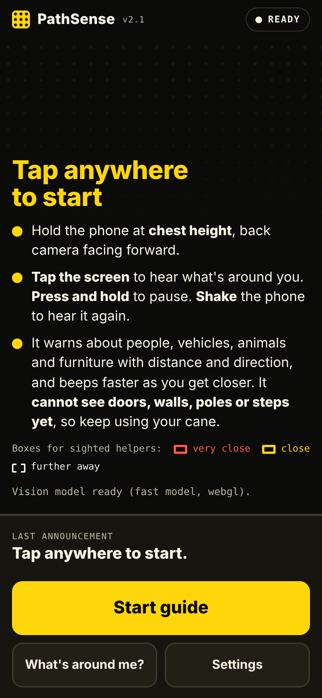
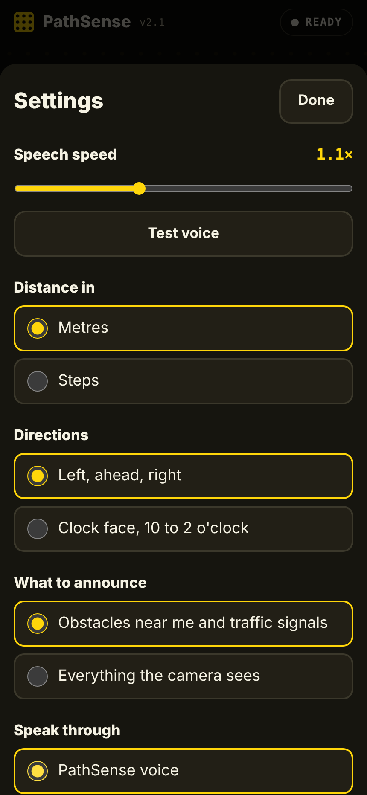
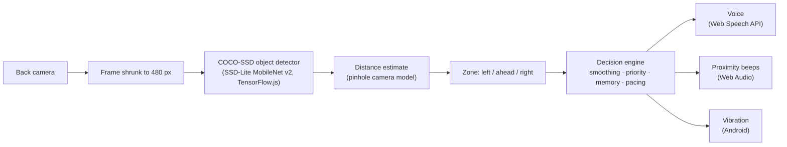

<div align="center">


# PathSense

**Hear what's in your path.**
An AI walking assistant for visually impaired people. It runs in the phone's browser, sees through the back camera, and speaks obstacles with their distance and direction. Everything runs on the phone; no video leaves the device.

[](https://hadesnorse-afk.github.io/pathsense/)


 &nbsp; 

</div>

> "Person, about 3 metres, ahead."
> "Stop. Person, about 1 metre, ahead. Try going around on your right."

## Try it on your phone


1. Scan the QR code, or open **https://hadesnorse-afk.github.io/pathsense/** in **Safari** (iPhone) or **Chrome** (Android).
2. Allow the camera when asked. It turns on by itself.
3. **Tap anywhere once** to turn on the voice. Phones block sound from web pages until the screen is touched, so that one tap can't be skipped.
4. Hold the phone at chest height with the back camera facing forward, and walk slowly.

Check that the version next to "PathSense" matches the badge above. If it doesn't, close the tab and open the link again.

<br clear="right">

## Using it without looking

| Gesture | What happens |
|---|---|
| Tap anywhere on the camera view | Hear what's around you, nearest first, with distances |
| Press and hold | Pause or resume |
| Shake the phone | Hear what's around you again |
| Switch away and come back | Camera resumes on its own |

With **VoiceOver** or **TalkBack** on, the camera view is one big button: double-tap it to hear what's around you. In Settings, choose **Speak through → My screen reader** so the two voices don't overlap.

## What it can and can't do

| Works now | Not yet |
|---|---|
| People, two-wheelers, bicycles, cars, buses, trucks | Doors (open or closed) |
| Dogs, cows, horses, goats | Walls |
| Benches, chairs, tables, sofas, TVs, fridges, plant pots | Poles, bollards, kerbs, steps, stairs |
| Traffic lights and stop signs | E-scooters, construction barriers, crosswalk buttons |
| Distance in metres or steps, direction as left/ahead/right or clock face | Reading signs |

It works best **outdoors**, where obstacles are seen from a distance. Indoors, most obstacles are doors, walls and furniture up close, which the current model handles poorly. The "Not yet" column is what the campus model in the roadmap adds. Because it can't see everything, **PathSense never says the path is clear**.

## How it works



**Detection.** Each camera frame goes through COCO-SSD, a single-shot detector trained on the 80 COCO object classes. It runs on the phone's GPU through WebGL. If Safari's WebGL fails, it falls back to WebAssembly, then to plain CPU.

**Distance.** Each object class has a typical real height (a person is about 1.7 m, a chair about 0.9 m). With the camera's field of view, the pinhole model gives:

```
distance ≈ real_height × focal_px / box_height_px
focal_px  = (frame_long_side_px / 2) / tan(FOV / 2)        FOV ≈ 70°
```

A box cut off by the frame edge looks smaller than the object really is, so the estimate is capped by box size in that case.

**Decision engine.** This is what turns raw detections into calm, useful speech:
- **Smoothing:** an object must appear in 2 of 3 frames before it's announced, unless it's very close.
- **Priority:** what's in your path comes first, then moving things, then nearest. Things to the side are only mentioned when they're about to touch you.
- **Pacing:** one message at a time, with a 2.5 s quiet gap. "Stop" warnings skip the queue and cut in instantly.
- **Memory:** if something close in your path suddenly disappears, it has usually filled the whole camera view. The app keeps warning for 3 s instead of going silent.
- **Beeps:** like a car parking sensor, the beeps speed up as the nearest thing ahead gets closer.

## Testing with friends

**Safety first.** Walk right beside your tester the whole time, in a quiet, flat area with no traffic, stairs or drops. The app misses things.

1. Set up a short route with 4–5 obstacles: a person standing still, a parked two-wheeler, a bench, a chair.
2. In Settings, tap **Clear log**. Let the tester walk the route twice with their eyes closed.
3. Note every obstacle it **warned** about, every one it **missed**, and every **false alarm**.
4. In Settings, tap **Copy as CSV** to copy the session log.
5. **[Send a test report](https://github.com/hadesnorse-afk/pathsense/issues/new?template=test-report.yml)**. The form takes about 3 minutes. No GitHub account? Send the same details on WhatsApp instead.

Tests with sighted people who close their eyes are pilot tests. They find bugs, but they don't replace testing with visually impaired users.

## Tuning

Constants at the top of the script in [`index.html`](index.html):

| Constant | Default | What it does |
|---|---|---|
| `CAMERA_FOV_DEG` | `70` | Camera field of view along the long side. Raise it if distances read too far, lower it if too near |
| `VERY_CLOSE_M` | `1.2` | Nearer than this: "Stop." ahead, "Careful." on the sides |
| `CLOSE_M` | `2.6` | Nearer than this: announced as an obstacle |
| `REPEAT_MS` | `[20000, 12000, 6000]` | Repeat the same object on the same side after (far, close, very close) |
| `QUIET_GAP_MS` | `2500` | Silence after each message. "Stop" warnings skip it |
| `MEMORY_MS` | `3000` | How long to keep warning about an obstacle that vanished while close |
| `LOOP_GAP_MS` | `40` | Pause between detections; raise it if the phone gets hot |

Typical object heights used for distance live in the `CLASSES` table.

## Roadmap

- [x] **Core app:** camera, obstacle detection, distance, spoken directions, hands-free gestures
- [ ] **Campus model:** a custom model trained on campus photos for doors, walls, stairs, poles, kerbs, e-scooters, construction barriers and crosswalk buttons
- [ ] **Signs and entrances:** read specific local signs and find the exact entrance of a building
- [ ] **User study:** testing with 5 visually impaired people through a local association for the blind

See the [changelog](CHANGELOG.md) for what changed in each version.

## Run it locally

It's a single [`index.html`](index.html) with no build step.

```bash
git clone https://github.com/hadesnorse-afk/pathsense.git
cd pathsense
python -m http.server 8000
# open http://localhost:8000 (localhost counts as secure, so the webcam works)
```

Opening the file directly, or from the Files app or an AirDrop, won't work: browsers only allow the camera on `https` or `localhost`.

## Tech stack

TensorFlow.js 4.22 (WebGL, WebAssembly and CPU backends) · COCO-SSD 2.2.3 · Web Speech API · Web Audio API · Screen Wake Lock · GitHub Pages

## About

Built by [@hadesnorse-afk](https://github.com/hadesnorse-afk), an AI & ML student at **Vishwakarma University, Pune**.

PathSense supports a white cane or guide dog. It does not replace them.

## License

[MIT](LICENSE)
